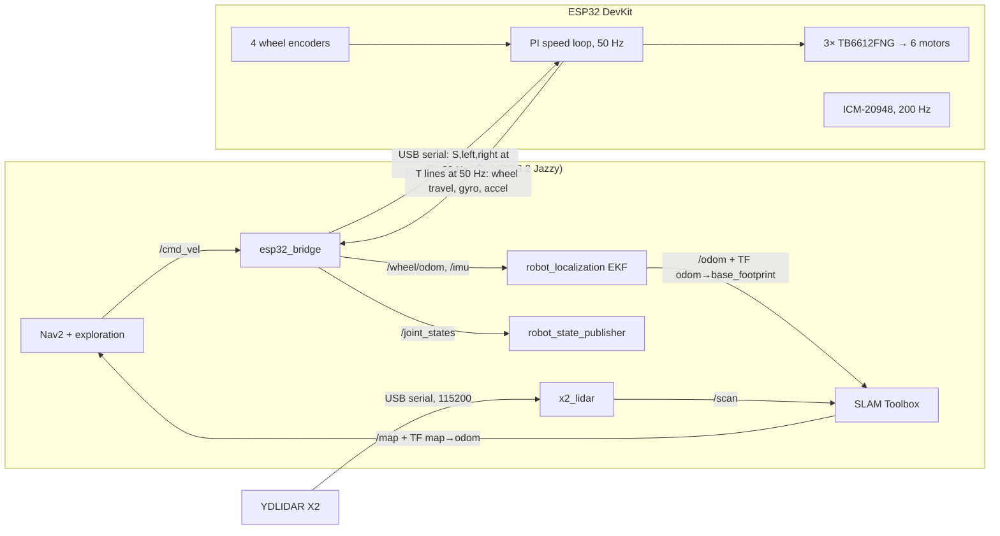

# Hardware architecture

**The Raspberry Pi 4 is the brain; the ESP32 is the controller** (the user's decision,
2026-10-28). The Pi runs ROS 2: SLAM, Nav2, exploration, the EKF, the mesh relay, and the
LiDAR driver. The ESP32 does everything that needs hard timing: motor PWM, encoder counting,
the speed loop, IMU sampling, and the safety stop. They are joined by one USB cable. The Pi's
own GPIO pins are not used.

## Why this split
- **Timing.** On the Pi, Python drove the PWM by software and counted encoder pulses in
  callbacks; with SLAM and Nav2 loading the CPU, both jitter and pulses get missed. The ESP32
  has hardware PWM (LEDC) and dedicated interrupts, and nothing else to do.
- **Safety.** If the Pi stalls, crashes or the cable comes out, the ESP32 stops the motors
  itself 0.5 s after the last command.
- **One ROS interface.** The bridge publishes the same topics as the Gazebo simulation
  ([[Topics]]), so SLAM, Nav2 and exploration run on the robot without changes.
- **Fusion stays in ROS.** The ESP32 sends raw measurements (wheel travel, gyro, accel), not a
  pose. The EKF on the Pi fuses them ([[Odometry fusion]]), so the fusion can be tuned
  without reflashing, and the same EKF config serves the simulation.

## Who does what
| Job | Where | Rate |
|-----|-------|------|
| Motor PWM, 20 kHz | ESP32 ([[ESP32 firmware]]) | continuous |
| Speed loop per side (feed-forward + PI) | ESP32 | 50 Hz |
| Encoder counting (interrupts) | ESP32 | every pulse |
| IMU sampling, averaged per report | ESP32 | 200 Hz in, 50 Hz out |
| Watchdog stop | ESP32 | 0.5 s after the last command |
| `/cmd_vel` → side speeds (skid-steer kinematics) | Pi, [[esp32_bridge]] | 20 Hz to the ESP32 |
| Wheel odometry, slip check, `/imu`, `/joint_states` | Pi, [[esp32_bridge]] | 50 Hz |
| Fusion: `/odom`, TF `odom → base_footprint` | Pi, EKF | 30 Hz |
| LiDAR packets → `/scan` | Pi, [[x2_lidar]] | 7 Hz |
| SLAM, Nav2, exploration, mesh relay | Pi | as in simulation |

Kinematics (the effective track width) live on the Pi; wheel size, encoder resolution and
the speed-loop gains live on the ESP32. Each number is set in exactly one place.

## Before 2026-10-28
The first design drove the motors from the Pi's GPIO (`explorer_base`) and read an MPU-9250
on the Pi's I²C (`mpu9250_imu`). Both were replaced; they are in git history
([[Hardware files]]). The sensor parts are listed in [[Robot model]].
